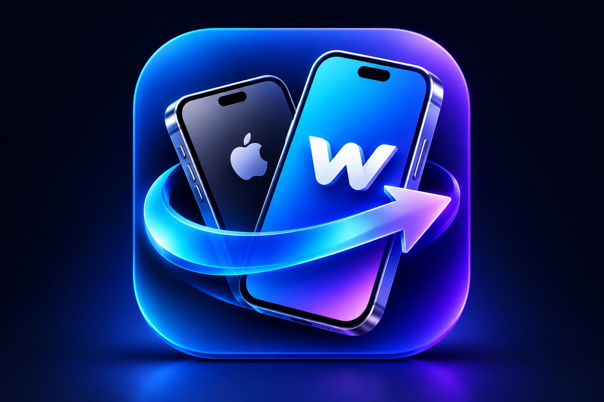

# WireShift Desktop (`wireshift-desktop`)

<p align="center">
  
</p>

<p align="center">
  
</p>

<p align="center">
  <strong>Ultra-Fast Cable-Based iPhone Migration & Hardware Diagnostics</strong><br/>
  iPhone sotuvchilari, servis ustalari va oddiy foydalanuvchilar uchun.
</p>

<p align="center">
  
  
  
  
</p>

---

## 📥 O'rnatish (Apple Silicon Mac)

Terminal'ni oching va bitta buyruqni yozing — eng oson yo'l, hech qanday ogohlantirish chiqmaydi:

```bash
curl -fsSL https://github.com/azimxxm/wireshift-desktop/releases/latest/download/install.sh | bash
```

Yoki [Releases](https://github.com/azimxxm/wireshift-desktop/releases/latest) sahifasidan `.pkg` faylini yuklab o'rnating
(birinchi ochishda: System Settings → Privacy & Security → **Open Anyway**).

Homebrew yoki boshqa dastur kerak emas — iPhone bilan ishlash uchun kerakli hamma narsa ilova ichida.

---

## ⚡ Imkoniyatlar

1. 🖼️ **Rasm va videolarni Mac'ga ko'chirish** — hammasi, faqat videolar yoki faqat rasmlar; albom papkalari saqlanadi,
   Mac'da bor fayllar qayta ko'chirilmaydi, rasm tahrirlari (AAE) birga saqlanadi.
2. 🎞️ **Galereya** — telefondagi rasm va videolarni ko'rish (video telefondan to'g'ridan-to'g'ri o'ynaydi), bittalab tanlab saqlash.
3. 🔌 **Kabel tezligi** — haqiqiy ulanish tezligi, 64 MB o'qib o'lchash va qaysi kabel qancha tezlik berishi.
4. 🔍 **Diagnostika** — batareya salomatligi, sikllar, mAh, xotira, model/hudud (masalan J/A), IMEI, SIM va boshqalar.

Ilova telefondagi fayllarni faqat o'qiydi — hech narsa o'chirilmaydi yoki o'zgartirilmaydi.

---

## 🎨 Color Design System

The complete color design system is established in [`design-system/`](./design-system/):
- [`design-system/COLOR_SYSTEM.md`](./design-system/COLOR_SYSTEM.md) — Comprehensive design token manual and WCAG 2.2 AA audit.
- [`design-system/theme.css`](./design-system/theme.css) — Production CSS custom properties for Dark & Light modes.
- [`design-system/tokens.json`](./design-system/tokens.json) — JSON design tokens format.
