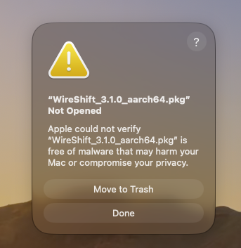
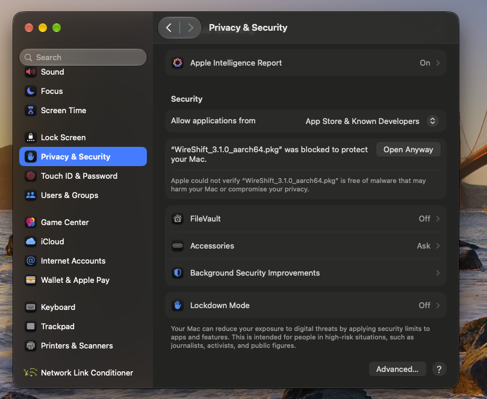
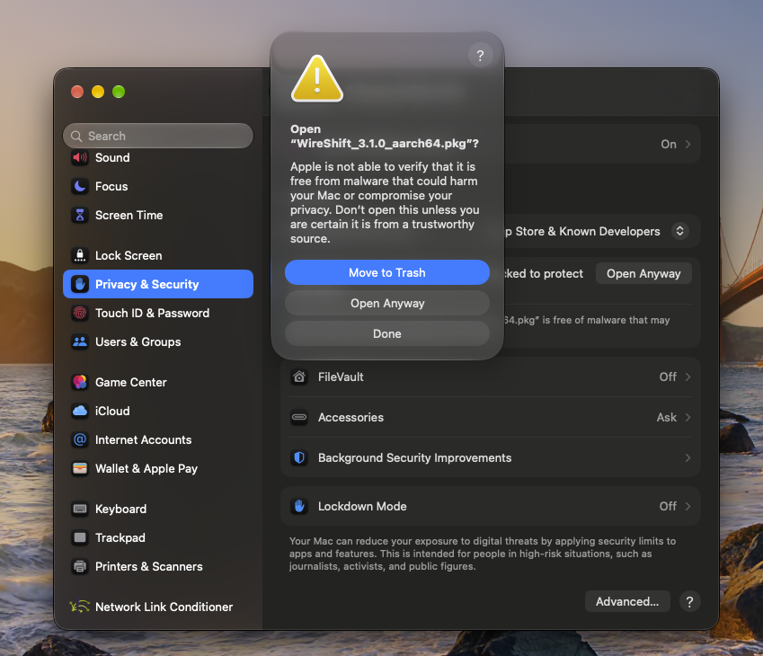
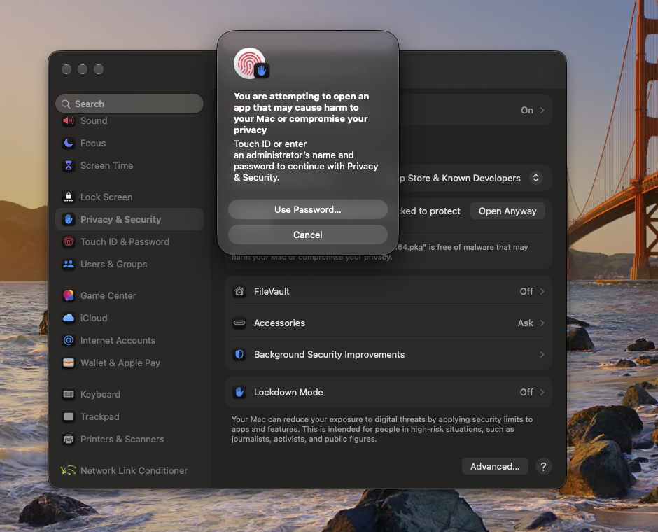
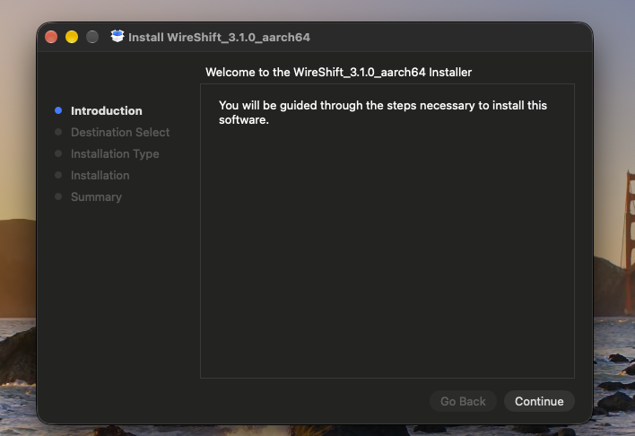
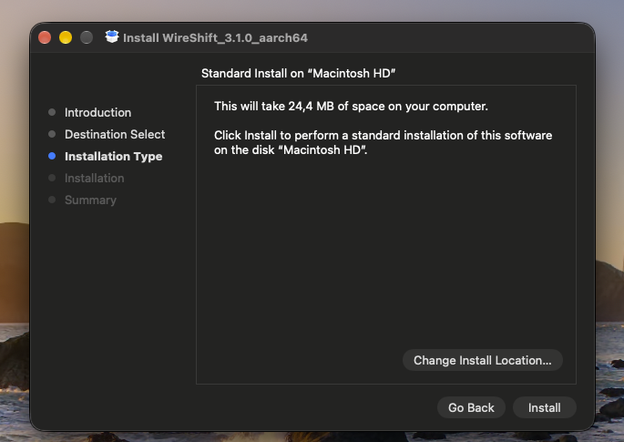
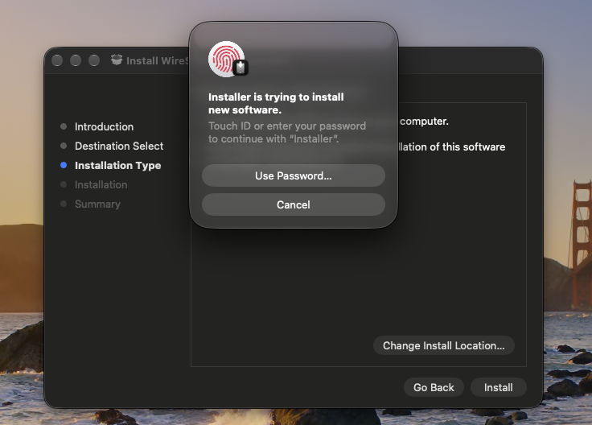
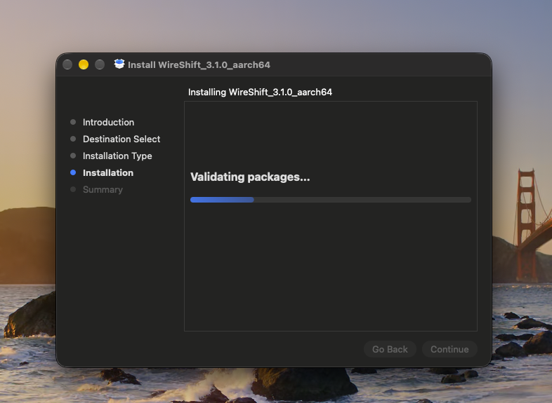
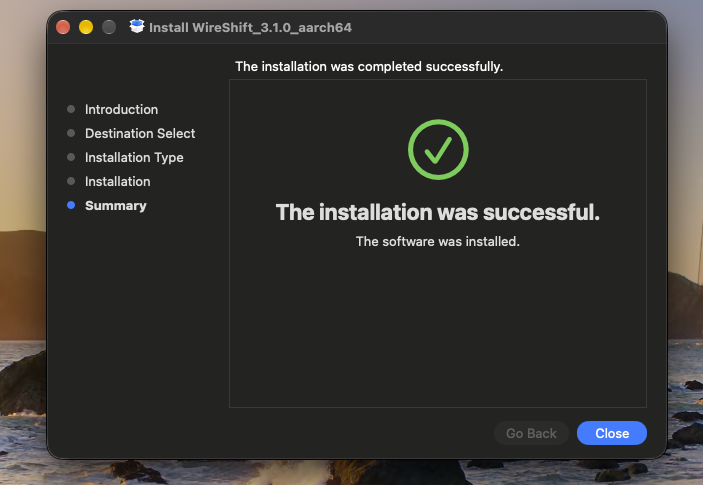
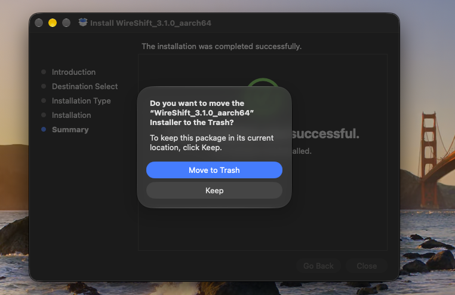

# WireShift Desktop (`wireshift-desktop`)

<p align="center">
  
</p>

<p align="center">
  
</p>

<p align="center">
  <strong>Ultra-Fast Cable-Based iPhone Migration & Hardware Diagnostics</strong><br/>
  iPhone sotuvchilari, servis ustalari va oddiy foydalanuvchilar uchun.
</p>

<p align="center">
  
  
  
  
</p>

---

## 📥 O'rnatish

### Talablar

| | |
|---|---|
| Kompyuter | Apple Silicon Mac (M1, M2, M3, M4). Intel Mac'lar qo'llab-quvvatlanmaydi |
| Tizim | macOS 11 Big Sur yoki yangiroq |
| Telefon | iPhone (USB-C yoki Lightning), kabel orqali ulangan |
| Qo'shimcha dastur | **Kerak emas** — Homebrew, iTunes yoki boshqa narsa o'rnatish shart emas |

### 1-usul: Terminal orqali (tavsiya etiladi)

Eng oson yo'l — hech qanday ogohlantirish chiqmaydi.

1. **Terminal**'ni oching (Spotlight: `⌘ Space` → «Terminal»).
2. Quyidagi buyruqni nusxalab, Terminal'ga qo'ying va `Enter` bosing:

   ```bash
   curl -fsSL https://github.com/azimxxm/wireshift-desktop/releases/latest/download/install.sh | bash
   ```

3. Skript so'nggi versiyani yuklab oladi, `Applications` papkasiga o'rnatadi va ilovani ochadi.

Agar `/Applications` ga yozish ruxsati bo'lmasa, ilova `~/Applications` ga o'rnatiladi — parol so'ralmaydi.

### 2-usul: `.pkg` o'rnatuvchi

1. [Releases](https://github.com/azimxxm/wireshift-desktop/releases/latest) sahifasidan `WireShift_x.x.x_aarch64.pkg` ni yuklab oling.
2. Faylni oching. macOS **«Apple could not verify…»** deb ogohlantirsa — **Done** ni bosing.
3. **System Settings → Privacy & Security** ni oching, pastga tushing va **Open Anyway** ni bosing.
4. `.pkg` ni qayta oching va o'rnatishni tugating. WireShift `Applications` papkasida paydo bo'ladi.

> Ogohlantirish ilova Apple'da notarizatsiya qilinmagani uchun chiqadi. Bu faqat bir marta, o'rnatishda bo'ladi.

### 3-usul: `.dmg`

1. Releases sahifasidan `WireShift_x.x.x_aarch64.dmg` ni yuklab oching.
2. `WireShift.app` ni `Applications` papkasiga torting.
3. Birinchi ochishda ogohlantirish chiqsa — 2-usuldagi 3-qadam (**Open Anyway**).

### Birinchi ulanish

1. iPhone'ni kabel bilan Mac'ga ulang.
2. Telefon ekranini oching va **«Ishonish» (Trust This Computer)** ni bosing, parolni kiriting.
3. WireShift chap paneldagi **Qurilmalar** ro'yxatida telefonni ko'rsatadi.

### Yangilash

1-usuldagi buyruqni qayta ishga tushiring — eski versiya yopiladi va yangisi bilan almashtiriladi.
Sozlamalar (saqlash papkasi va boshqalar) saqlanib qoladi.

### O'chirish

```bash
rm -rf /Applications/WireShift.app ~/.cache/wireshift
```

Ikkinchi yo'l rasm eskizlari keshini o'chiradi. Mac'ga ko'chirilgan rasm va videolaringizga (`~/Pictures/WireShift_Exports`) tegilmaydi.

### Muammolar va yechimlar

| Muammo | Yechim |
|---|---|
| Telefon ko'rinmayapti | Kabelni qayta ulang, telefon ekranini oching va «Ishonish»ni bosing. Chap paneldagi ↻ tugmasi (`⌘R`) qayta qidiradi |
| «Ishonish» chiqmadi | iPhone'da: Sozlamalar → Umumiy → O'tkazish yoki tiklash → Tiklash → **Joylashuv va maxfiylikni tiklash**, so'ng qayta ulang |
| «Apple could not verify» | System Settings → Privacy & Security → **Open Anyway**, yoki 1-usuldan foydalaning |
| «WireShift is damaged» | Terminal'da: `xattr -dr com.apple.quarantine /Applications/WireShift.app` |
| Ko'chirish sekin (~38 MB/s) | Kabel USB 2.0. **Kabel tezligi** bo'limida qaysi kabel kerakligi ko'rsatilgan (iPhone 15 Pro va yangi Pro modellar uchun 10 Gbps kabel taxminan 10 barobar tez) |
| Intel Mac'da ishlamayapti | Hozircha faqat Apple Silicon qo'llab-quvvatlanadi |

---

## ⚡ Imkoniyatlar

1. 🖼️ **Rasm va videolarni Mac'ga ko'chirish** — hammasi, faqat videolar yoki faqat rasmlar; albom papkalari saqlanadi,
   Mac'da bor fayllar qayta ko'chirilmaydi, rasm tahrirlari (AAE) birga saqlanadi.
2. 🎞️ **Galereya** — telefondagi rasm va videolarni ko'rish (video telefondan to'g'ridan-to'g'ri o'ynaydi), bittalab tanlab saqlash.
3. 🔌 **Kabel tezligi** — haqiqiy ulanish tezligi, 64 MB o'qib o'lchash va qaysi kabel qancha tezlik berishi.
4. 📲 **iPhone'ga yuborish (Mac → iPhone)** — video, rasm va fayllarni Mac'dan telefonga kabel orqali yuboradi.
   Fayllar telefondagi ilova (masalan VLC) papkasiga tushadi: **Files → On My iPhone → ilova → WireShift …**,
   u yerdan **Select All → Share → Save to Photos**. Finder'dan tortib tashlash ham ishlaydi.
5. 📶 **Wi-Fi orqali (QR kod)** — kabelsiz: QR'ni iPhone kamerasi bilan skanerlang, Safari'da ochilgan sahifadan
   rasm/videolarni Mac'ga yuboring yoki Mac'dagi fayllarni oling. Ilova o'rnatish shart emas, bitta Wi-Fi kerak.
6. 🔍 **Diagnostika** — batareya salomatligi, sikllar, mAh, xotira, model/hudud (masalan J/A), IMEI, SIM va boshqalar.

Ilova telefondagi rasm va videolarni faqat o'qiydi — hech narsa o'chirilmaydi yoki o'zgartirilmaydi.
Yagona yozish — «iPhone'ga yuborish»da tanlangan ilovaning yangi papkasiga fayl qo'shish.

---

## 📦 Installation (macOS)

WireShift ships as a standard macOS installer package: `WireShift_<version>_aarch64.pkg` (`aarch64` = Apple Silicon, M1 and newer).

> **Why does macOS block it?** The package is not yet signed with an Apple Developer ID and notarized by Apple. Gatekeeper therefore cannot confirm who published it and refuses to open it the first time. This is expected for apps distributed outside the App Store — you only need to approve it **once**. Steps 1–4 approve the package, steps 5–10 are the normal installation.

### Step 1 — First launch is blocked ("Not Opened")

**What you see:** after double-clicking the `.pkg`, macOS shows *"WireShift_…_aarch64.pkg" Not Opened — Apple could not verify … is free of malware*.

**Why:** Gatekeeper blocks every unnotarized file downloaded from the internet on its first launch. Nothing has been installed yet.

**What to do:** click **Done**. ⚠️ Do **not** click *Move to Trash* — that deletes the installer and you would have to download it again.

<p align="center"></p>

### Step 2 — Find the blocked package in Privacy & Security

**What to do:** open  → **System Settings → Privacy & Security** and scroll down to the **Security** section.

**What you see:** the line *"WireShift_…_aarch64.pkg" was blocked to protect your Mac* with an **Open Anyway** button next to it. This line only appears for about an hour after the attempt in Step 1 — if it is missing, repeat Step 1.

**What to do:** click **Open Anyway**. Leave *Allow applications from* as it is — there is no need to lower the security level of your whole Mac.

<p align="center"></p>

### Step 3 — Confirm that you trust the package

**What you see:** a second warning, *Open "WireShift_…_aarch64.pkg"?*, with three buttons: *Move to Trash*, *Open Anyway* and *Done*.

**Why:** macOS asks you to confirm explicitly that the file comes from a source you trust (download it only from the official WireShift release page).

**What to do:** click **Open Anyway**.

<p align="center"></p>

### Step 4 — Authorize the exception with Touch ID or password

**What you see:** *You are attempting to open an app that may cause harm to your Mac… Touch ID or enter an administrator's name and password to continue with Privacy & Security.*

**Why:** only an administrator may add a Gatekeeper exception. The warning text is generic — macOS shows it for every unnotarized app.

**What to do:** touch the **Touch ID** sensor, or click **Use Password…** and enter your Mac login password. The installer opens right after this.

<p align="center"></p>

### Step 5 — Installer: Introduction

**What you see:** the *Install WireShift_…_aarch64* window with the welcome text. The left sidebar shows all stages: Introduction → Destination Select → Installation Type → Installation → Summary.

**What to do:** click **Continue**.

<p align="center"></p>

### Step 6 — Installer: Installation Type

**What you see:** *Standard Install on "Macintosh HD"* — the app takes about **25 MB** of disk space and is installed into `/Applications`.

**What to do:** click **Install**. Use *Change Install Location…* only if you need to install on another disk; the default is correct for almost everyone.

<p align="center"></p>

### Step 7 — Authorize the installation

**What you see:** *Installer is trying to install new software. Touch ID or enter your password to continue with "Installer".*

**Why:** writing into `/Applications` requires administrator rights. This is a separate prompt from Step 4: Step 4 allowed the file to open, this one allows it to install.

**What to do:** confirm with **Touch ID** or **Use Password…**.

<p align="center"></p>

### Step 8 — Installation in progress

**What you see:** *Installing WireShift_…_aarch64 — Validating packages…* with a progress bar.

**What to do:** nothing — wait a few seconds. Do not close the window while the bar is moving.

<p align="center"></p>

### Step 9 — Installation complete

**What you see:** a green check mark and *The installation was successful. The software was installed.*

**What to do:** click **Close**.

<p align="center"></p>

### Step 10 — Keep or delete the installer file

**What you see:** *Do you want to move the "WireShift_…_aarch64" Installer to the Trash?*

**Why:** the app is already installed; the `.pkg` file is no longer needed to run it.

**What to do:** click **Move to Trash** to free up space, or **Keep** if you want to reinstall WireShift later without downloading it again. Either choice is safe.

<p align="center"></p>

### ✅ Launch WireShift

Open **WireShift** from the **Applications** folder, Launchpad or Spotlight (`⌘ Space` → type *WireShift*). The Gatekeeper approval is remembered, so no warning appears again for this version.

> **Terminal alternative (replaces Steps 1–4):** the block comes from the `com.apple.quarantine` attribute that macOS adds to downloaded files. Removing it lets the installer open straight away at Step 5:
> ```bash
> xattr -d com.apple.quarantine ~/Downloads/WireShift_*_aarch64.pkg
> open ~/Downloads/WireShift_*_aarch64.pkg
> ```

---

## 🎨 Color Design System

The complete color design system is established in [`design-system/`](./design-system/):

- [`design-system/COLOR_SYSTEM.md`](./design-system/COLOR_SYSTEM.md) — Comprehensive design token manual and WCAG 2.2 AA audit.
- [`design-system/theme.css`](./design-system/theme.css) — Production CSS custom properties for Dark & Light modes.
- [`design-system/tokens.json`](./design-system/tokens.json) — JSON design tokens format.
